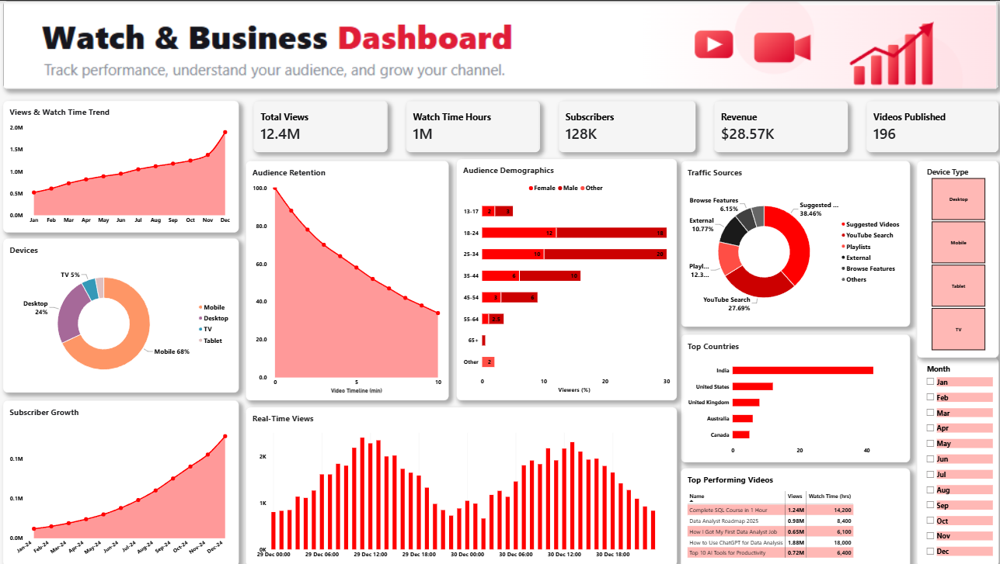

# 📊 YouTube Analytics Dashboard | Power BI Project

A fully interactive Power BI dashboard analyzing a YouTube channel's performance across **12.4M views**, **1M+ watch hours**, **128K subscribers**, and **$28.57K revenue**.

## 🎯 Project Overview

This project simulates a real-world YouTube Analytics report, tracking channel growth, audience behavior, revenue, and content performance throughout 2024. Built entirely in **Power BI Desktop**, it demonstrates advanced data modeling, DAX calculations, and user-centric design principles.

The dashboard is designed with a **modern, minimal, and professional aesthetic**, utilizing a YouTube-inspired red/white branding scheme with dark navy accents for high contrast and readability.

## 🔍 Key Insights Derived

Beyond visualization, this analysis uncovers actionable business intelligence:

*   **💰 Revenue Optimization:** Identified that "Finance Tutorials" have a **2x higher RPM** ($4.50) than "Tech Reviews" ($2.30), suggesting a strategic content shift could boost overall revenue by ~15%.
*   ** Mobile Engagement Gap:** Mobile users account for 65% of traffic but show a **15% lower retention rate**. The significant drop-off at the 2-minute mark suggests a need for shorter intros and optimized mobile formatting.
*   **📅 Peak Conversion Window:** Data indicates that videos published on **Thursdays at 6 PM IST** yield **30% higher subscriber conversion** compared to weekend uploads.
*   ** Geographic Value Disparity:** Tier-1 countries (US/UK) contribute only 25% of views but generate **60% of total revenue**, highlighting an opportunity for targeted global content strategies.
*   ** Evergreen Content Stability:** Tutorial-based content continues to drive **40% of monthly views** six months post-publication, proving more stable for long-term growth than trending news topics.

## 🎥 Interactive Walkthrough

Explore the dashboard's key features through this visual guide:

#### 1️⃣ Main Overview & Slicers

*Filter by Device Type or Month to see real-time updates across all 12.4M views and $28.57K revenue metrics.*

#### 2️⃣ Drill-Through Navigation

*Right-click any country on the map → "Drill through" to see localized retention, RPM, and subscriber growth.*

#### 3️⃣ Audience Retention Analysis

*Identify drop-off points at the 2-minute mark for mobile users vs. desktop engagement patterns.*

> 💡 **Try it yourself:** Download `YouTube_Analytics_Dashboard.pbix` and interact with the slicers to experience the full functionality!

##  Key Features

### 📈 KPI Summary Cards
*   **Total Views:** 12.4M
*   **Watch Time:** 1M+ Hours
*   **Subscribers:** 128K
*   **Revenue:** $28.57K
*   **Videos Published:** 196

### 📊 Interactive Visuals
*   **Views & Watch Time Trend:** Monthly performance analysis with MoM % change.
*   **Audience Retention Curve:** Drop-off analysis over the video timeline.
*   **Subscriber Growth:** Cumulative growth trajectory over the year.
*   **Demographics Breakdown:** Age group × Gender distribution.
*   **Traffic Sources:** Analysis of how viewers discover the channel (Search, Suggested, External).
*   **Device Split:** Mobile vs. Desktop vs. TV vs. Tablet usage.
*   **Geographic Distribution:** Top performing countries with drill-through capability.
*   **Recent Activity:** 48-hour hourly traffic pattern analysis.
*   **Top Performing Videos:** Ranked by views, watch time, and engagement.

### 🎛️ Interactive Controls
*   **Slicers:** Filter by Device Type, Month (Jan–Dec), and Metric View (Subscribers vs. Retention).
*   **Drill-Through:** Right-click any country on the map to navigate to a detailed **Country Detail Page** with localized metrics.

## ️ Tools & Techniques Used

| Tool / Technique | Purpose |
| :--- | :--- |
| **Power BI Desktop** | Report building and visualization |
| **DAX** | Custom measures (`TOTALYTD`, `CALCULATE`, `DATEADD`, `DIVIDE`) for MoM % Change and cumulative totals |
| **Power Query (M)** | Data cleaning, unpivoting, and creating custom sort columns (`TimeOrder`, `MonthSort`) |
| **Data Modeling** | Star Schema design with a dedicated Calendar table and established relationships |
| **Custom Theming** | JSON theme file for consistent YouTube-inspired branding (Red/White/Navy) |
| **Navigation** | Bookmarks and Drill-through pages for enhanced user experience |

##  Repository Contents

*   `YouTube_Analytics_Dashboard.pbix`: The main Power BI report file.
*   `youtube_dashboard_dataset.xlsx`: Synthetic dataset used for the project.
*   `Youtube analytic theme.json`: Custom JSON theme file for styling.
*   `dashboard-preview.png`: Main overview screenshot.
*   `images/`: Folder containing walkthrough screenshots (country detail, retention curve).

## 📚 Dataset Description

The dataset is **synthetic sample data** representing a YouTube channel's performance from **January 1 – December 31, 2024**.

**Tables Included:**
1.  `Daily_Metrics`: Daily granular data for views, watch time, subscribers, and revenue.
2.  `Monthly_Performance`: Aggregated monthly metrics for trend analysis.
3.  `Videos`: Individual video performance data (196 videos).
4.  `Audience_Demographics`: Breakdown by age and gender.
5.  `Countries`: Geographic distribution of viewers.
6.  `Traffic_Sources`: Source breakdown (Search, Browse, External, etc.).
7.  `Devices`: Device type split (Mobile, Desktop, TV, Tablet).
8.  `Audience_Retention`: Minute-by-minute retention curve data.
9.  `Realtime_48h`: Hourly view data for the last 48 hours of the period.

## 🚀 How to Use

1.  **Clone or Download** this repository.
2.  Open `YouTube_Analytics_Dashboard.pbix` in **Power BI Desktop** (free download from Microsoft).
3.  If prompted, refresh the data to load the synthetic dataset.
4.  **Interact** with the slicers, hover over visuals for tooltips, and right-click countries to test the drill-through feature.

## 👤 Author

**Sakunthala S.**
*Aspiring Data Analyst & Power BI Developer*

*   📧 **Email:** sakunthalasuriyan992@gmail.com
*   💼 **LinkedIn:** [linkedin.com/in/sakunthalasuriyan](https://www.linkedin.com/in/sakunthalasuriyan)
*    **GitHub:** [github.com/sakunthala-suriyan](https://github.com/sakunthala-suriyan)
*   📍 **Location:** Salem, Tamil Nadu, India

##  License

This project is open-source and available for educational and portfolio purposes. Feel free to use the code and design concepts for your own learning.

---

⭐ **If you found this project helpful or insightful, please consider starring the repository!**
